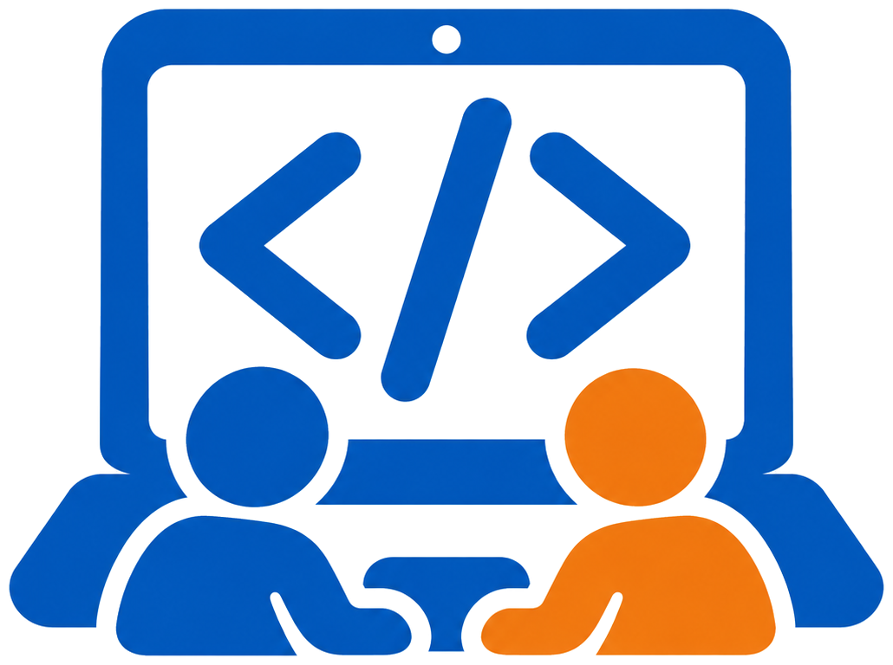

# じゃんけんで体験するオブジェクト指向

> このリポジトリは自動生成されています。直接 push しても、次回の更新で上書きされますのでご注意ください。

同じ「じゃんけんゲーム」を、書き方を変えて3回作ります。最後に「CPUを増やす」改造をして、オブジェクト指向（OOP）で作っておくと何がうれしいのかを体験します。

| STEP | フォルダ | 作るもの | 書き方 |
| --- | --- | --- | --- |
| 1 | `step1-cui` | コンソールで遊ぶじゃんけん | main メソッドの中に、if 文・switch 文・繰り返しだけで書く |
| 2 | `step2-gui-oop` | ボタンで遊ぶじゃんけん | 「手」「参加者」「進行役」をクラスに分けて書く |
| 3 | `step3-multi` | あなた＋CPU 3人のじゃんけん | STEP2 のクラスを使って、人数を増やす |

各フォルダの README.md に、そのSTEPでやること（TODO）が書いてあります。

## 準備：プロジェクトをクローンする

1. IntelliJ IDEA を起動する
2. ようこそ画面の「VCS から取得」を押す（プロジェクトを開いている場合は、メニューの「ファイル」→「新規」→「バージョン管理からのプロジェクト...」）
3. 「URL」欄に、講師から伝えられたリポジトリのURLを貼り付けて「クローン」を押す
4. 「このプロジェクトを信頼しますか？」と聞かれたら「プロジェクトを信頼」を押す

JDKが設定されていないと表示された場合は、メニュー「ファイル」→「プロジェクト構造...」→「プロジェクト」で、バージョン25のJDKを選んでください。一覧に無い場合は「JDK のダウンロード...」からダウンロードします。

## 実行方法

画面右上の実行構成の一覧から「STEP1 CUI版」などを選び、緑の実行ボタン（▶）を押します。STEP1 は画面下のコンソールに文字を入力して遊びます。

## 進め方の約束

- 各STEPのソースコードにある「TODO」の部分を書きます。それ以外の部分は、読むだけでかまいません。
- `step3-multi` には、STEP2 を書き終えた状態のコードが入っています。**STEP2 が終わるまで `step3-multi` フォルダは開かないでください。**
